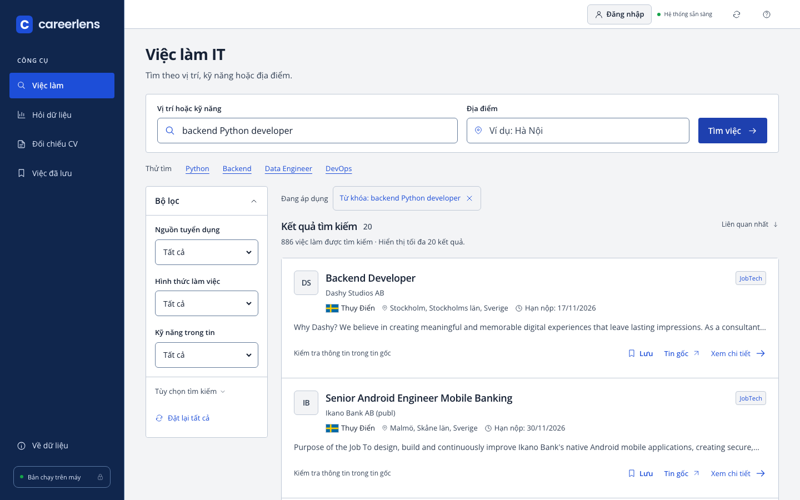
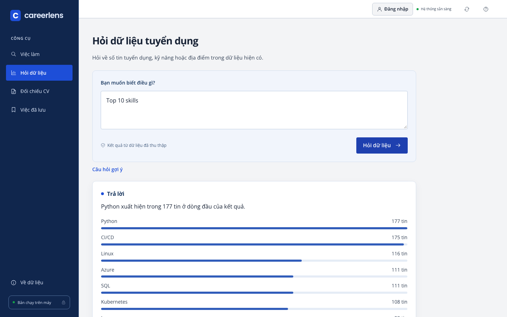
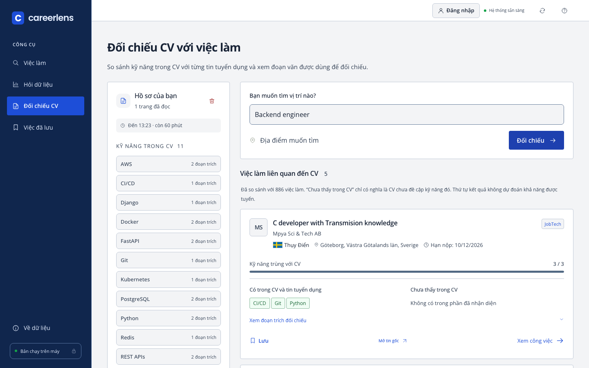
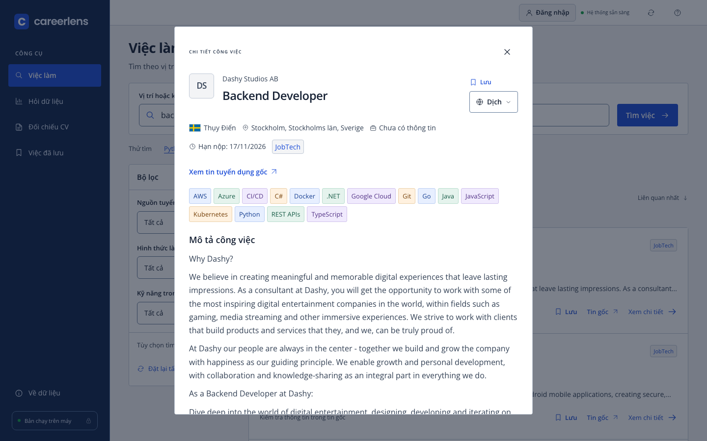
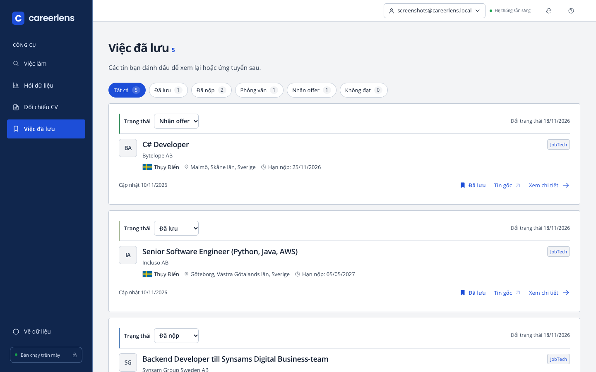

# CareerLens: AI Career Intelligence

[](https://github.com/bachthao4321/ai-career-intelligence/actions/workflows/ci.yml)

*Tiếng Việt: [README.vi.md](README.vi.md)*

A job-search platform for IT roles in Vietnam and Europe. It lets you:

- **Search jobs** in natural language (Vietnamese, English or Swedish) with hybrid lexical and semantic retrieval.
- **Ask questions** about the job market, such as "Top 10 skills", answered by an agent that writes guarded SQL.
- **Match a CV** against postings and see which skills a job asks for that the CV does not mention.
- **Track applications**: save jobs and move them through *saved → applied → interviewing → offer / rejected*.

Stack: Python 3.12, FastAPI, PostgreSQL, Qdrant, LangGraph, ONNX MiniLM (runs locally) and Docker Compose. The UI is a dependency-free ES-module front end.



| Ask the data | CV matching |
|---|---|
|  |  |
| **Job detail** | **Application tracking** |
|  |  |

## Highlights

| Area | What it does |
|---|---|
| **Ingestion** | Pulls postings from JobTech, Remotive and the career pages of employers with Vietnam offices (Greenhouse, Lever and Ashby boards, plus two company sites). Each posting gets skills with evidence spans, classified as required, preferred or negated. Seniority, years of experience, salary and deadline are also extracted. |
| **Hybrid search** | BM25 and multilingual embeddings are fused with weighted Reciprocal Rank Fusion (2 : 1). Search falls back to BM25 when the vector index is missing or stale. |
| **Ask agent** (`/ask`) | A LangGraph router sends each question to search, analytics or a clarifying reply. Common questions run on templates with no model call. Model-written SQL must pass an AST allowlist and runs under a **read-only Postgres role** with a statement timeout. |
| **CV matching** | Upload a text PDF to extract skills, rank matching jobs and list the skills each job mentions that the CV does not. It runs fully locally: the PDF is never stored and the profile expires after 1 hour. The PDF parser runs in a resource-limited worker process. |
| **Accounts** | Email and password accounts hashed with scrypt, server-side sessions in HttpOnly cookies, same-origin checks on writes and login rate limits. Users can save up to 500 jobs, each with an application status. |
| **Operations** | Production Compose with a Caddy (TLS) reverse proxy, read-only containers, a separate least-privilege DB role, a password gate and per-client quotas, plus backup and restore-drill scripts. |

## Architecture

```
                 ┌──────────────── FastAPI (app/main.py) ────────────────┐
 Browser / curl ─▶ middleware: host check → rate limit → demo gate        │
                 │        │                                              │
                 │   api/routes  (parse request, map errors → HTTP)      │
                 │        │ Depends(api/deps)                            │
                 │   services    (search, ask, cv, accounts, jobs, ...)  │
                 │      │                    │                           │
                 │ repositories (SQL)   integrations (Qdrant, LLM, ONNX) │
                 └──────┼────────────────────┼───────────────────────────┘
                   PostgreSQL             Qdrant / model API
```

Each layer only calls the layer below it.

| Folder | Role |
|---|---|
| `app/api/` | Thin routers. `deps.py` is the only place that resolves settings, DB sessions and services. |
| `app/schemas/` | Pydantic request and response models |
| `app/services/` | Business logic: `search/`, `ask/` (LangGraph agent), `cv/`, `accounts`, `jobs`, `translation/` |
| `app/repositories/` | SQLAlchemy queries and quotas. Every job query goes through the source-visibility filter. |
| `app/integrations/` | External clients: Qdrant, ONNX embeddings, LLM runtime |
| `app/ingestion/` | Pipeline: source → normalize → extract skills and facts → store |
| `app/core/` | Config, security middleware, service container |
| `app/cli/` | Operator CLI: `python -m app.cli <group> <command>` |

## Quick start

You need Docker with Compose v2.

```bash
git clone https://github.com/bachthao4321/ai-career-intelligence.git
cd ai-career-intelligence
cp .env.example .env
docker compose up --build --wait --wait-timeout 120
```

- UI: <http://localhost:8000/>
- API docs: <http://localhost:8000/docs>
- Readiness check: `curl localhost:8000/ready`

A fresh checkout has no jobs. Load synthetic or real data:

```bash
uv sync --frozen
uv run --frozen python -m app.cli ingest import examples/jobs.synthetic.json   # synthetic
uv run --frozen python -m app.cli ingest fetch jobtech --limit 150             # prints a snapshot path
uv run --frozen python -m app.cli ingest import data/raw/jobtech-YYYY-MM-DD.json
uv run --frozen python -m app.cli ingest fetch employers                       # Vietnam employer boards

# Semantic or hybrid search needs the model and an index
uv run --frozen python -m app.cli search download-model
uv run --frozen python -m app.cli search index
```

The `/admin/import` and `/admin/index` endpoints do the same over HTTP. To use them, set `ADMIN_KEY` (32 or more characters) in `.env` and send it as the `X-Admin-Key` header.

## API examples

```bash
curl --json '{"query":"backend Python","top_k":5}' localhost:8000/search
curl --json '{"question":"How many jobs mention Python?"}' localhost:8000/ask
curl -H 'Content-Type: application/pdf' --data-binary @my-cv.pdf localhost:8000/cv
```

## Development

```bash
uv run --frozen ruff check . && uv run --frozen mypy
uv run --frozen pytest -m 'not integration'
RUN_INTEGRATION=1 uv run --frozen pytest -m integration   # needs the Docker stack
node --test tests/ui/*.test.mjs
```

CI runs all of the above, including integration tests against real PostgreSQL and Qdrant, with no API keys. Integration tests write only to throwaway schemas.

## Deploying

`compose.production.yaml` is a standalone production stack:
- Caddy terminates TLS.
- The app containers are read-only and drop all capabilities.
- The API uses a separate least-privilege DB role.
- A password gate and per-client quotas are always on.
- Local-only research sources are hidden.

On a VPS with Docker and a DNS record pointing to it:

```bash
cp infra/production.env.example .env.production    # fill every value with different random secrets
uv run --frozen python -m app.cli search download-model
docker compose -f compose.production.yaml --env-file .env.production up -d --build --wait
```

Then load data through `/admin/import` and build the index with `/admin/index`. Use `scripts/operations.py backup` for cold backups.

## Limitations

- The local snapshot has about 900 postings. Most come from JobTech (Sweden), so it does not yet represent the Vietnamese market.
- Search quality has not been measured against human-reviewed relevance labels.
- Skills are what a posting *mentions*. A skill missing from a CV does not mean the candidate lacks it, and match scores are heuristics, not hiring probabilities.
- Job data stays local and is never committed. Sources whose terms do not allow redistribution are hidden outside local mode and are never sent to an external model.
